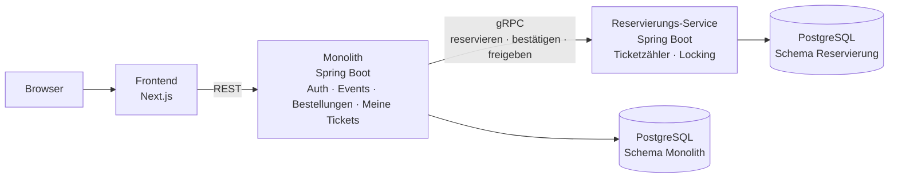

# 🎟️ Overex

[](https://github.com/Umex10/overex/actions/workflows/backend-verify-ci.yml)
[](https://github.com/Umex10/overex/actions/workflows/web-build-ci.yml)
[](https://github.com/Umex10/overex/actions/workflows/web-unit-ci.yml)
[](https://github.com/Umex10/overex/actions/workflows/web-e2e-ci.yml)
[](https://github.com/Umex10/overex/pkgs/container/overex-backend)

> Eine Ticketplattform für Events mit hohem Andrang: Wenn tausende Käufer gleichzeitig auf wenige Tickets zugreifen, darf **nie mehr verkauft werden, als es gibt**, und das System muss **unter Last erreichbar bleiben**.

Overex ist meine **Projektarbeit** (12.10.2026 – 26.01.2027, Betreuung: Herr Schwab) und die Grundlage für meine **Bachelorarbeit**.

---

## 🎯 Problem und Ziel

Beim Vorverkauf beliebter Events greifen sehr viele Käufer im selben Moment auf ein kleines Ticketkontingent zu. Daraus entstehen zwei Probleme:

1. **Overselling:** Ohne saubere Synchronisation verkauft das System mehr Tickets, als es gibt.
2. **Lastspitzen:** Der Ansturm trifft den Teil, der Tickets zählt und reserviert. Andere Funktionen wie der Login sollen davon nicht mitgerissen werden.

Die Projektarbeit vergleicht drei Lösungsansätze (nur Monolith, nur Microservices, Monolith + ein ausgelagerter Service) und setzt den dritten um. Der Monolith enthält den Kern, und nur die Reservierung, die den Ansturm abbekommt, wird ein eigener, skalierbarer Service.

**Nachweise am Ende:**
- Concurrency-Test: 200 gleichzeitige Käufer auf 50 Tickets, genau 50 kommen durch
- Lasttest mit k6: 1.000 Käufer auf 100 Tickets, nie zu viel verkauft, Autoscaling greift, Login bleibt erreichbar

---

## 🏗️ Architektur



| Bestandteil | Wo | Aufgabe |
|---|---|---|
| **Frontend** | Next.js | Events ansehen, Ticket kaufen, Login, Meine Tickets. Spricht nur mit dem Monolithen. |
| **Auth** | Monolith | Registrieren, Login, JWT (RS256) mit JWKS-Endpoint. Übernommen aus AuthKit. |
| **Events** | Monolith | Veranstaltungen und Ticketkategorien mit Preis, Datum, Ort und Verkaufsstart. |
| **Bestellungen** | Monolith | Schließt einen Kauf ab (simulierte Zahlung, Bestellnummer). Nur mit gültiger Reservierung. |
| **Meine Tickets** | Monolith | Zeigt dem User seine gekauften Tickets. |
| **Reservierung** | eigener Service | Zählt freie Tickets, hält ein Ticket 10 Minuten fest und verhindert Overselling mit pessimistischem Locking. |
| **gRPC** | Monolith ↔ Reservierung | Reservieren, Bestätigen, Freigeben, jeweils mit Zeitlimit. |
| **Datenbank** | PostgreSQL | Ein Schema pro Service, jeder greift nur auf sein eigenes zu. |
| **Kubernetes** | lokaler Cluster | Monolith mit 2 festen Kopien, Reservierung mit 1–10 Kopien je nach Last (HPA). |
| **CI/CD** | GitHub Actions | Baut und testet bei jedem Push, legt Docker-Images in ghcr.io ab. |

**Ablauf eines Kaufs:** Ticket kaufen klicken → Monolith fragt per gRPC die Reservierung → Reservierung sperrt kurz den Ticketzähler, zieht 1 ab und hält das Ticket 10 Minuten fest → Käufer füllt die Bezahlseite aus → Monolith legt die Bestellung an und bestätigt die Reservierung → Ticket erscheint in „Meine Tickets". Wird nicht rechtzeitig bezahlt, gibt die Reservierung das Ticket wieder frei.

---

## 📍 Aktueller Stand

Overex startet auf der Basis von **AuthKit** (Release v1.0.0), meinem eigenen Auth-Service. Davon ist bereits fertig:

- ✅ Registrierung und Login, Access-Token (15 Min.) + Refresh-Token im HTTP-only-Cookie
- ✅ JWT mit **RS256**, öffentlicher Schlüssel über **JWKS-Endpoint**, Prüfung per OAuth2 Resource Server
- ✅ Schlüsselverwaltung (Dev-Key-Generator, Skript für Produktionsschlüssel)
- ✅ Tests in drei Ebenen (Unit, Slice, Integration) mit JaCoCo, Web-Unit- und Playwright-E2E-Tests
- ✅ GitHub Actions für Backend, Web-Build/Unit/E2E, Docker-Build und Image-Publish nach ghcr.io

Als Nächstes kommen Events, Reservierungs-Service, gRPC, Bestellungen und Kubernetes (siehe Roadmap).

---

## 🗓️ Roadmap

| Phase | Zeitraum | Ziel |
|---|---|---|
| 0 · Start | 12.10. – 20.10. | Monorepo, Domänenmodell, Konzept |
| 1 · Core + Frontend | 21.10. – 08.11. | Events im Monolithen, erste Screens, gRPC- und Kubernetes-Spike |
| 2 · Reservierung + gRPC | 10.11. – 13.12. | Reservierungs-Service, pessimistisches Locking, gRPC, kompletter Kaufablauf |
| 3 · Kubernetes | 14.12. – 10.01. | Gesamtsystem auf Kubernetes, Autoscaling, Lasttest mit k6 |
| 4 · Abschluss | 11.01. – 26.01. | Dokumentation, Präsentation, Puffer |

**Nicht Teil der Projektarbeit (Ausblick Bachelorarbeit):** Warteraum, Rate Limiting und Load Shedding.

Der Fortschritt ist pro Meilenstein in [docs/meilenstein-doku](docs/meilenstein-doku/README.md) dokumentiert.

---

## 🚀 Schnellstart

```bash
# 0. JWT-Schlüssel erzeugen (einmal nach dem Klonen, überschreibt nichts)
scripts/generate-jwt-keys.sh

# 1. Datenbank + Backend (+ Swagger UI) starten
docker compose up -d

# 2. Frontend starten
cd apps/web
npm install
npm run dev          # → http://localhost:3000
```

Swagger UI: **http://localhost:8080/api/v1/swagger-ui.html**. Alle Varianten (komplett in Docker, manuell, einzelne Services) stehen in [docs/RUNNING.md](docs/RUNNING.md).

---

## 🗺️ Repository

```
overex/
├── apps/
│   ├── backend/        Monolith: Spring Boot 4 · Java 21 · Spring Security · JPA · springdoc
│   └── web/            Frontend: Next.js 16 · React 19 · Redux Toolkit Query · Tailwind v4 · shadcn/ui
├── .github/workflows/         CI: Backend- und Web-Tests, Docker-Build/Publish
├── docker-compose.yml         Postgres + Backend + Swagger UI
├── docker-compose.test.yml    Wegwerf-Postgres für die E2E-Tests
├── scripts/                   generate-jwt-keys.sh
└── docs/                      Technische Doku und Meilenstein-Doku
```

---

## 📚 Dokumentation

| Dokument | Inhalt |
|---|---|
| [docs/ARCHITECTURE.md](docs/ARCHITECTURE.md) | Zusammenspiel der Teile mit Ablaufdiagrammen |
| [docs/BACKEND_FLOW.md](docs/BACKEND_FLOW.md) | Aufrufkette im Backend pro Endpoint, inkl. Security-Filter |
| [docs/RUNNING.md](docs/RUNNING.md) | Starten, Docker-Container, Ports, Umgebungsvariablen |
| [docs/SWAGGER.md](docs/SWAGGER.md) | Die Live-API-Doku |
| [docs/TESTING.md](docs/TESTING.md) | Backend- und Web-Tests |
| [docs/SECURITY.md](docs/SECURITY.md) | Token- und Cookie-Modell |
| [docs/CI.md](docs/CI.md) | GitHub Actions, Docker-Image, Releases |
| [docs/meilenstein-doku](docs/meilenstein-doku/README.md) | Zeitleiste der Meilensteine |

---

## 🛠️ Tech-Stack

**Backend:** Spring Boot 4, Java 21, Spring Security (OAuth2 Resource Server), Spring Data JPA, PostgreSQL / H2, springdoc-openapi; geplant: gRPC.
**Frontend:** Next.js 16 (App Router), React 19, Redux Toolkit Query, react-hook-form + Zod, Tailwind CSS v4, shadcn/ui.
**Betrieb:** Docker, GitHub Actions, ghcr.io; geplant: Kubernetes (HPA, Ingress), k6.
**Tests:** JUnit 5, Mockito, MockMvc, JaCoCo, Vitest, Playwright.

---

Umejr Dzinovic · Projektarbeit 2026/27
