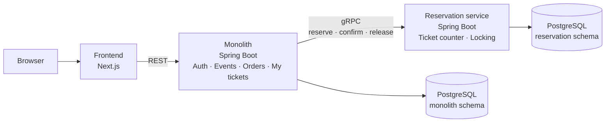

# 🎟️ Overex

[](https://github.com/Umex10/overex/actions/workflows/backend-verify-ci.yml)
[](https://github.com/Umex10/overex/actions/workflows/web-build-ci.yml)
[](https://github.com/Umex10/overex/actions/workflows/web-unit-ci.yml)
[](https://github.com/Umex10/overex/actions/workflows/web-e2e-ci.yml)
[](https://github.com/Umex10/overex/pkgs/container/overex-backend)

> A ticketing platform for high-demand events: when thousands of buyers go for a handful of tickets at the same moment, the system must **never sell more tickets than exist** and must **stay available under load**.

Overex is my **project work** (Oct 12, 2026 – Jan 26, 2027, supervised by Mr. Schwab) and the foundation for my **bachelor's thesis**.

---

## 🎯 Issue and goal

When tickets for a popular event go on sale, a large number of buyers hit a small ticket contingent at the same moment. This causes two issues:

1. **Overselling:** without proper synchronization, the system sells more tickets than exist.
2. **Load spikes:** the rush hits the part that counts and reserves tickets. Other features, such as sign-in, must not be dragged down with it.

The project work compares three approaches (monolith only, microservices only, monolith + one extracted service) and implements the third. The monolith holds the core, and only the reservation part, which takes the rush, becomes its own scalable service.

**Proof at the end:**
- Concurrency test: 200 simultaneous buyers for 50 tickets, exactly 50 succeed
- Load test with k6: 1,000 buyers for 100 tickets, never oversold, autoscaling kicks in, sign-in stays available

---

## 🏗️ Architecture



| Component | Where | Responsibility |
|---|---|---|
| **Frontend** | Next.js | Browse events, buy tickets, sign in, my tickets. Talks only to the monolith. |
| **Auth** | Monolith | Sign-up, sign-in, JWT (RS256) with a JWKS endpoint. Taken over from AuthKit. |
| **Events** | Monolith | Events and their ticket categories with price, date, venue and sale start. |
| **Orders** | Monolith | Completes a purchase (simulated payment, order number). Only with a valid reservation. |
| **My tickets** | Monolith | Shows users the tickets they bought. |
| **Reservation** | separate service | Counts free tickets, holds a ticket for 10 minutes and prevents overselling with pessimistic locking. |
| **gRPC** | Monolith ↔ Reservation | Reserve, confirm, release, each with a timeout. |
| **Database** | PostgreSQL | One schema per service; each service only accesses its own. |
| **Kubernetes** | local cluster | Monolith with 2 fixed replicas, reservation service with 1–10 replicas depending on load (HPA). |
| **CI/CD** | GitHub Actions | Builds and tests on every push, publishes Docker images to ghcr.io. |

**How a purchase works:** click "buy ticket" → the monolith asks the reservation service via gRPC → the reservation service briefly locks the ticket counter, subtracts 1 and holds the ticket for 10 minutes → the buyer fills in the payment page → the monolith creates the order and confirms the reservation → the ticket shows up in "My tickets". If payment does not happen in time, the reservation service releases the ticket again.

---

## 📍 Current status

Overex starts from **AuthKit** (release v1.0.0), my own auth service. Already done:

- ✅ Sign-up and sign-in, access token (15 min) + refresh token in an HTTP-only cookie
- ✅ JWT signed with **RS256**, public key via a **JWKS endpoint**, verified by the OAuth2 Resource Server
- ✅ Key management (dev key generator, script for production keys)
- ✅ Tests on three levels (unit, slice, integration) with JaCoCo, web unit tests and Playwright e2e tests
- ✅ GitHub Actions for the backend, web build/unit/e2e, Docker build and image publish to ghcr.io

Next up: events, the reservation service, gRPC, orders and Kubernetes (see roadmap).

---

## 🗓️ Roadmap

| Phase | Period | Goal |
|---|---|---|
| 0 · Start | Oct 12 – Oct 20 | Monorepo, domain model, concept |
| 1 · Core + frontend | Oct 21 – Nov 8 | Events in the monolith, first screens, gRPC and Kubernetes spike |
| 2 · Reservation + gRPC | Nov 10 – Dec 13 | Reservation service, pessimistic locking, gRPC, complete purchase flow |
| 3 · Kubernetes | Dec 14 – Jan 10 | Whole system on Kubernetes, autoscaling, load test with k6 |
| 4 · Wrap-up | Jan 11 – Jan 26 | Documentation, presentation, buffer |

**Not part of the project work (outlook for the bachelor's thesis):** waiting room, rate limiting and load shedding.

Progress is documented per milestone in [docs/meilenstein-doku](docs/meilenstein-doku/README.md).

---

## 🚀 Quick start

```bash
# 0. Create the JWT keys (once after cloning; never overwrites)
scripts/generate-jwt-keys.sh

# 1. Start the database + backend (+ Swagger UI)
docker compose up -d

# 2. Start the frontend
cd apps/web
npm install
npm run dev          # → http://localhost:3000
```

Swagger UI: **http://localhost:8080/api/v1/swagger-ui.html**. All variants (fully in Docker, manual, individual services) are described in [docs/RUNNING.md](docs/RUNNING.md).

---

## 🗺️ Repository

```
overex/
├── apps/
│   ├── backend/        Monolith: Spring Boot 4 · Java 21 · Spring Security · JPA · springdoc
│   └── web/            Frontend: Next.js 16 · React 19 · Redux Toolkit Query · Tailwind v4 · shadcn/ui
├── .github/workflows/         CI: backend and web tests, Docker build/publish
├── docker-compose.yml         Postgres + backend + Swagger UI
├── docker-compose.test.yml    Throwaway Postgres for the e2e tests
├── scripts/                   generate-jwt-keys.sh
└── docs/                      Technical docs and milestone docs
```

---

## 📚 Documentation

| Document | What it covers |
|---|---|
| [docs/DATA_MODEL.md](docs/DATA_MODEL.md) | ER model: entities, fields, relationships, status transitions |
| [docs/ARCHITECTURE.md](docs/ARCHITECTURE.md) | How the parts fit together, with flow diagrams |
| [docs/BACKEND_FLOW.md](docs/BACKEND_FLOW.md) | Backend call chain per endpoint, incl. the security filter chain |
| [docs/RUNNING.md](docs/RUNNING.md) | Running it, Docker containers, ports, environment variables |
| [docs/SWAGGER.md](docs/SWAGGER.md) | The live API docs |
| [docs/TESTING.md](docs/TESTING.md) | Backend and web tests |
| [docs/SECURITY.md](docs/SECURITY.md) | Token and cookie model |
| [docs/CI.md](docs/CI.md) | GitHub Actions, Docker image, releases |
| [docs/meilenstein-doku](docs/meilenstein-doku/README.md) | Milestone timeline |

---

## 🛠️ Tech stack

**Backend:** Spring Boot 4, Java 21, Spring Security (OAuth2 Resource Server), Spring Data JPA, PostgreSQL / H2, springdoc-openapi; planned: gRPC.
**Frontend:** Next.js 16 (App Router), React 19, Redux Toolkit Query, react-hook-form + Zod, Tailwind CSS v4, shadcn/ui.
**Operations:** Docker, GitHub Actions, ghcr.io; planned: Kubernetes (HPA, Ingress), k6.
**Testing:** JUnit 5, Mockito, MockMvc, JaCoCo, Vitest, Playwright.

---

Umejr Dzinovic · Project work 2026/27
