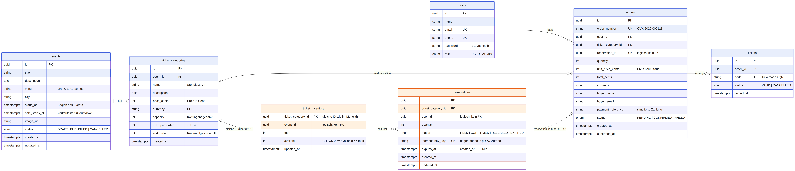
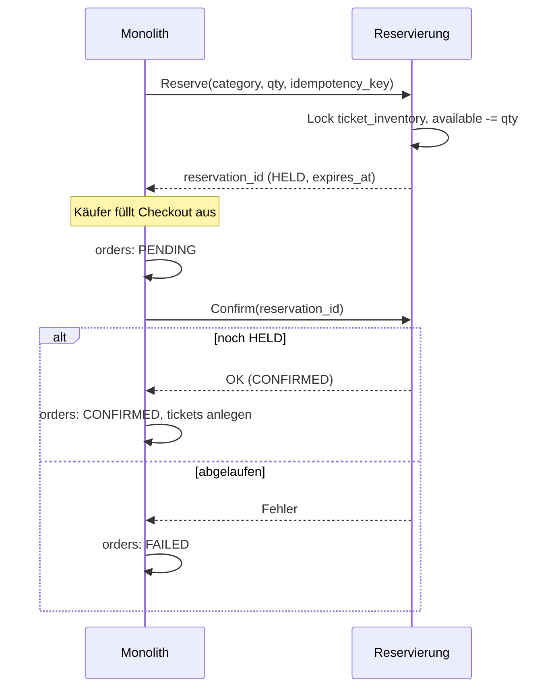

# Datenmodell

ER-Modell von Overex. Blau = Monolith (Schema `core`), orange = Reservierungs-Service (Schema `reservation`). Gestrichelte Linien sind **logische Verweise über die Service-Grenze**: Dort gibt es keinen Fremdschlüssel in der Datenbank, die Verbindung läuft über gRPC.

Quelle: [diagrams/datenmodell.mmd](diagrams/datenmodell.mmd) (Mermaid). Das Bild wird daraus erzeugt (PNG/SVG im selben Ordner).

---

## Monolith (Schema `core`)

### `users` (aus AuthKit, unverändert)
Registrierte Konten. `role` ist `USER` oder `ADMIN`.

### `events`
| Feld | Bedeutung |
|---|---|
| `venue`, `city` | Ort der Veranstaltung |
| `starts_at` | Beginn des Events |
| `sale_starts_at` | Verkaufsstart. Davor zeigt die Detailseite den Countdown, und der Monolith lehnt Reservierungen ab |
| `status` | `DRAFT` (nicht sichtbar), `PUBLISHED` (sichtbar), `CANCELLED` |

### `ticket_categories`
Eine Kategorie gehört zu genau einem Event (Stehplatz, VIP …).
| Feld | Bedeutung |
|---|---|
| `price_cents` | Preis als ganze Zahl in Cent, nie als `double` (Rundungsfehler) |
| `capacity` | Gesamtkontingent. Daraus wird einmal `ticket_inventory.total` angelegt |
| `max_per_order` | Höchstmenge pro Bestellung |
| `sort_order` | Reihenfolge auf der Detailseite |

Die **freien** Tickets stehen hier bewusst **nicht**. Sie gehören allein dem Reservierungs-Service. Für die Anzeige „Verfügbarkeit“ fragt der Monolith per gRPC nach.

### `orders`
Ein abgeschlossener Kauf **einer** Kategorie in beliebiger Menge (≤ `max_per_order`).
| Feld | Bedeutung |
|---|---|
| `order_number` | Für Menschen lesbar, z. B. `OVX-2026-000123` |
| `reservation_id` | ID der Reservierung im anderen Service. **UNIQUE**: pro Reservierung höchstens eine Bestellung |
| `unit_price_cents`, `total_cents` | Preis **zum Kaufzeitpunkt** kopiert, damit spätere Preisänderungen alte Bestellungen nicht verändern |
| `buyer_name`, `buyer_email` | Angaben aus dem Checkout-Formular (können vom Konto abweichen) |
| `payment_reference` | Kennung der simulierten Zahlung |
| `status` | `PENDING` → `CONFIRMED` oder `FAILED` (siehe Ablauf unten) |

### `tickets`
Ein Datensatz pro Ticket, also `quantity` viele pro Bestellung. Sie werden erst bei `CONFIRMED` erzeugt. „Meine Tickets“ = `tickets` → `orders` (`user_id`) → `ticket_categories` → `events`.

---

## Reservierungs-Service (Schema `reservation`)

### `ticket_inventory` (der Ticketzähler)
Eine Zeile pro Ticketkategorie. Der Primärschlüssel ist **dieselbe UUID** wie `ticket_categories.id`.
- `available` wird beim Reservieren unter **pessimistischem Lock** (`SELECT … FOR UPDATE`) verringert und beim Freigeben/Ablaufen wieder erhöht.
- Der DB-Constraint `CHECK (available >= 0 AND available <= total)` ist das letzte Sicherheitsnetz gegen Overselling.

### `reservations`
| Feld | Bedeutung |
|---|---|
| `status` | `HELD` (Ticket festgehalten) → `CONFIRMED` (gekauft) / `RELEASED` (vom Käufer abgebrochen) / `EXPIRED` (10 Min. abgelaufen) |
| `expires_at` | `created_at + 10 Minuten`. Ein geplanter Job setzt abgelaufene `HELD`-Reservierungen auf `EXPIRED` und gibt die Tickets zurück |
| `idempotency_key` | Vom Monolithen mitgeschickt. Kommt derselbe Aufruf nach einem Timeout nochmal, wird keine zweite Reservierung angelegt |

Index empfohlen auf `(status, expires_at)` für den Ablauf-Job.

---

## Ablauf und Statuswechsel

Die Bestellung wird zuerst als `PENDING` gespeichert und erst nach der Bestätigung durch den Reservierungs-Service `CONFIRMED`. So gibt es nie Tickets ohne bestätigte Reservierung, und ein Ausfall mitten im Ablauf hinterlässt einen sichtbaren Zustand statt eines halben Kaufs.

---

## Hinweise zur Umsetzung als JPA-Entities

- **IDs:** `UUID` mit `@GeneratedValue(strategy = GenerationType.UUID)` wie bei `User`. Ausnahme: `ticket_inventory.ticket_category_id` wird **nicht** generiert, sondern vom Monolithen übernommen.
- **Enums:** `@Enumerated(EnumType.STRING)`, nie `ORDINAL`.
- **Zeit:** `Instant` (Spalte `timestamptz`), `created_at`/`updated_at` z. B. mit `@CreationTimestamp` / `@UpdateTimestamp`.
- **Geld:** `int`/`long` in Cent.
- **Beziehungen:** `@ManyToOne(fetch = LAZY)` auf der FK-Seite (`TicketCategory.event`, `Order.user`, `Order.ticketCategory`, `Ticket.order`). Die logischen Verweise (`reservation_id`, `user_id` und `event_id` im Reservierungs-Service) sind **nur `UUID`-Felder**, keine Beziehungen.
- **Schemas:** `@Table(schema = "core")` bzw. `@Table(schema = "reservation")`. Jeder Service hat seinen eigenen DB-User und greift nur auf sein Schema zu.
- **Locking:** Im Repository des Reservierungs-Service `@Lock(LockModeType.PESSIMISTIC_WRITE)` auf der Abfrage, die `ticket_inventory` für die Reservierung lädt.
